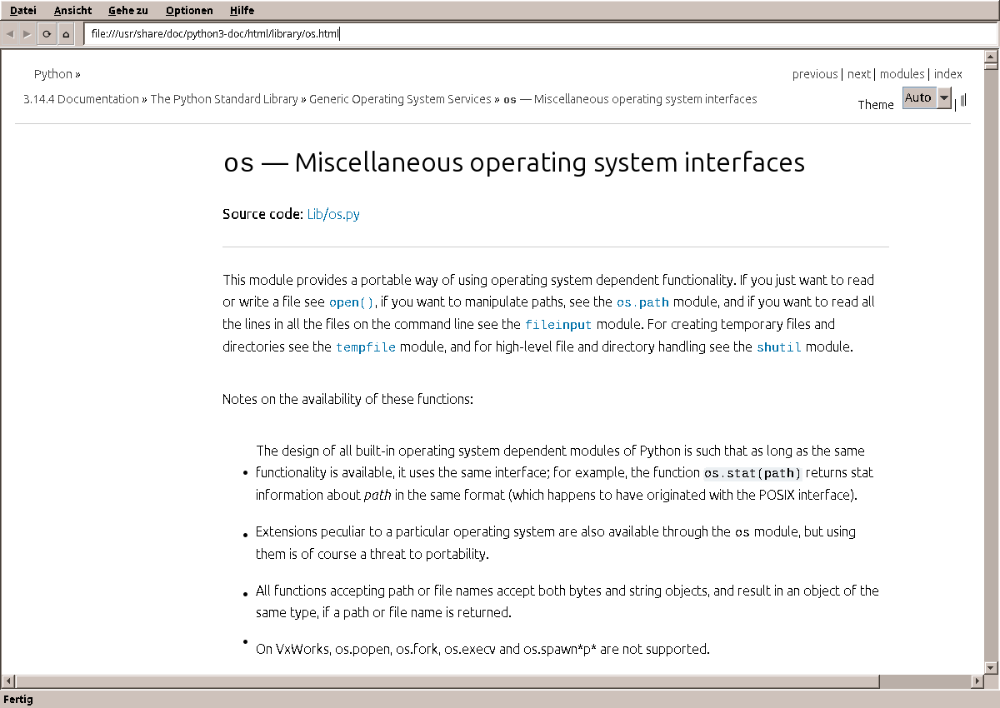

# amade-web

Documentation viewer of the [amadeOS](https://github.com/datazuul/amadeos) desktop: local HTML
rendered with [Flying Saucer](https://github.com/flyingsaucerproject/flyingsaucer) (XHTML +
CSS 2.1) in a Motif/CDE-styled Swing window, themed through
[amade-commons](https://github.com/datazuul/amade-commons).



It shows the documentation installed under `/usr/share/doc` and other local HTML, plain text and
compressed README and changelog files. Web links open in the web browser (Firefox ESR in amadeOS).

## Using it

```sh
amade-web                          # opens /usr/share/doc
amade-web docs/index.html          # a local file
amade-web guide.html#install       # ... scrolled to an anchor
amade-web https://example.org      # handed to the web browser
```

| Key | Action |
|---|---|
| Ctrl+L | Address field |
| Ctrl+O | Open a local file |
| Alt+Left / Alt+Right | Back / forward |
| Alt+Home | Home page (`/usr/share/doc`) |
| F5 | Reload |
| Ctrl+Plus / Ctrl+Minus / Ctrl+0 | Larger / smaller text / actual size |
| Ctrl+Q | Exit |

What it shows:

- **HTML** (`.html`, `.htm`, `.xhtml`): jsoup repairs the HTML the way browsers do and Flying Saucer
  renders it with its local style sheets and images. Scripts are removed; nothing is loaded from the
  network.
- **Directories**: their `index.html`, or a listing with folders first.
- **Text**: README, changelog, `.txt`, `.md` and other files without binary content, also when
  gzip-compressed (`changelog.Debian.gz`); UTF-8, or Latin-1 for older files.
- **Images**: PNG, JPEG, GIF and BMP.

Web links (`http:`, `https:`, `mailto:`, ...) go to the web browser and other files (PDF, office
documents, SVG) to their applications, both through `xdg-open`. The status bar shows the target of
the link under the mouse.

### Languages

English, German, French, Spanish and Italian. The application follows the desktop language;
*Options > Language* sets its own, applied at the next start.

### Engine

Flying Saucer 9.9 renders XHTML and CSS 2.1; jsoup 1.18 parses the HTML. Both are plain Java, so the
package works on every architecture and the application starts in about a second. Generated
documentation (DocBook, Sphinx, Javadoc) mostly looks as intended. What it does not do:

- CSS 3 layout (flexbox, grid) and some layouts with negative margins, e.g. the sidebar of Sphinx's
  classic theme does not appear
- JavaScript, so no search boxes of generated documentation
- SVG images

Until 0.1.0 amade-web used the JavaFX WebView (WebKit). Measured on the same documents (time from
JVM start until the page is laid out and painted, resident memory):

| | JavaFX 27 WebView | Flying Saucer |
|---|---|---|
| Debian package | 61 MB, `amd64` only, needs GTK 3 | 6 MB, `all` |
| Python `os` module page (large Sphinx page) | 2.3 s, 430 MB | 1.9 s, 280 MB |
| X Strike Force index (DocBook) | 2.2 s, 430 MB | 1.1 s, 207 MB |

## Building and testing

Requirements: Java 25 JDK; `dpkg-deb` for the Debian package.

`amade-commons` is taken from JitPack. If it is checked out next to this repository
(`../amade-commons`), Gradle builds that checkout instead.

```bash
./gradlew test                 # unit tests
./gradlew run                  # start the viewer
./gradlew run --args="docs/index.html"
./gradlew deb                  # build/distributions/amade-web_0.1.0_all.deb
./gradlew installToAmadeOs     # copy the .deb into ../amadeos/config/packages.chroot/
```

### Runtime packages

The Debian package depends on a Java 25 runtime only. It installs `amade-web.desktop`
(`Categories=Utility;Documentation;`), so the amadeOS front panel lists it in the Help drawer. It
registers for `text/html` as an *Open with* choice but not for `http`/`https` links; in amadeOS those
go to Firefox ESR.

### Windows

`./gradlew windowsInstaller` builds an installer with jpackage that includes a Java runtime, so Windows
users need no Java. It runs only on Windows; MSI and EXE also need
[WiX Toolset 3](https://github.com/wixtoolset/wix3/releases) on the `PATH` (JDK 25 also takes WiX 4/5).
Without `/usr/share/doc` the home page is the user's home directory.

```bat
gradlew windowsInstaller                            :: build\windows\msi\amade-web-0.1.0.msi
gradlew windowsInstaller -PinstallerType=exe        :: setup .exe
gradlew windowsInstaller -PinstallerType=app-image  :: folder with amade-web.exe, no WiX needed
```

The `windows` job in CI builds the MSI and a portable ZIP of the app image on every push; both are
in the `amade-web-windows` artifact of the workflow run. The installer is not code-signed, so
SmartScreen warns on first start.

## Roadmap

- [x] Local HTML, text, compressed files, images and directory listings; history, anchors, zoom
- [x] English, German, French, Spanish and Italian
- [ ] Help Viewer for the front panel: table of contents of the installed documentation
- [ ] Full-text search over `/usr/share/doc`
- [ ] Man pages (`man -Thtml`) and GNU info
- [ ] Bookmarks

## License

[EUPL-1.2](LICENSE)
